# MedCore HMS

> A modern, workspace-first Hospital Management System for clinical, administrative, pharmacy, inventory, scheduling, and billing workflows.

[](#technology-stack)
[](#technology-stack)
[](#security)
[](#technology-stack)
[](#technology-stack)

MedCore HMS is a full-stack hospital management application built around real operational workflows instead of isolated CRUD screens. The system combines a React/TypeScript client with a Java 21 Spring Boot backend, relational persistence, migration-managed schema evolution, JWT authentication, validation, and role-aware access boundaries.

The interface is intentionally designed as a **workspace-first clinical application**: users move from a command center into focused patient, doctor, appointment, clinical, pharmacy, inventory, and billing workspaces while keeping context visible.

---

## Table of Contents

- [Screenshots](#screenshots)
- [Product Overview](#product-overview)
- [Functional Modules](#functional-modules)
- [Technology Stack](#technology-stack)
- [Architecture](#architecture)
- [Frontend Structure](#frontend-structure)
- [Backend Structure](#backend-structure)
- [Security](#security)
- [Database & Migrations](#database--migrations)
- [Local Development](#local-development)
- [Quality Gates](#quality-gates)
- [Representative Clinical Workflows](#representative-clinical-workflows)
- [UX & Design System](#ux--design-system)
- [API Discovery](#api-discovery)
- [Testing Strategy](#testing-strategy)
- [Production Readiness Notes](#production-readiness-notes)
- [Release Checklist](#release-checklist)
- [Project Status](#project-status)
- [License](#license)
- [Author](#author)

---

## Screenshots

> A full walkthrough video is in progress — screenshots below cover the core workspaces in the meantime.

### Authentication & Command Center

| Login | Dashboard |
|---|---|
| 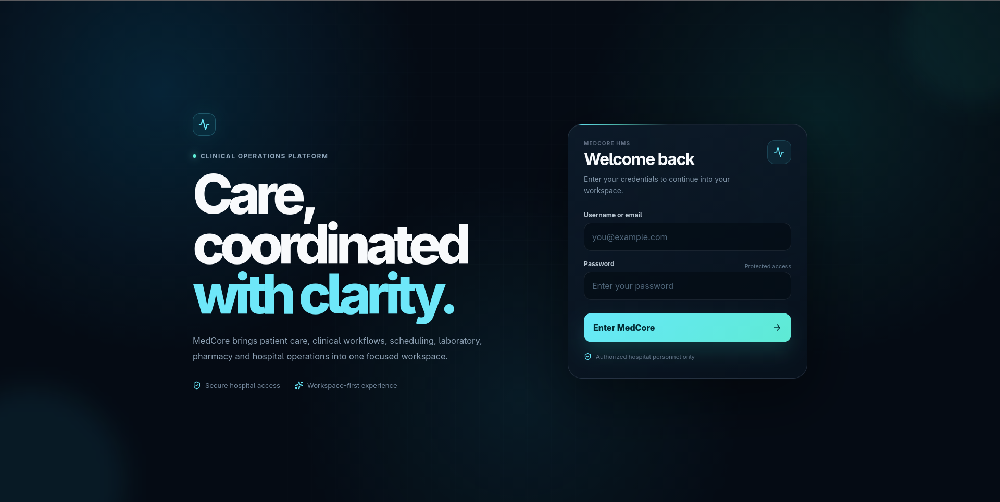 | 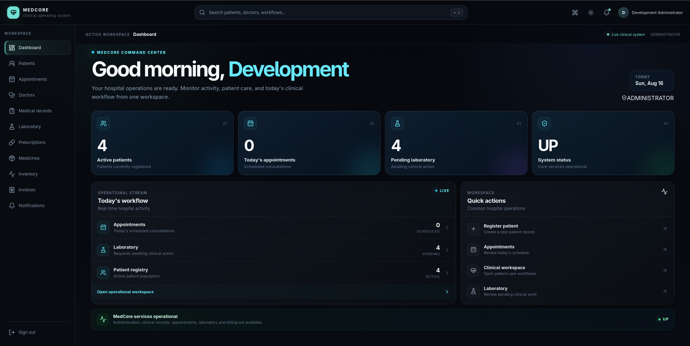 |

The dashboard provides an operational overview of current activity, system status, workflow shortcuts, and high-level metrics.

### Patients

| Patients Directory | Patient Detail |
|---|---|
| 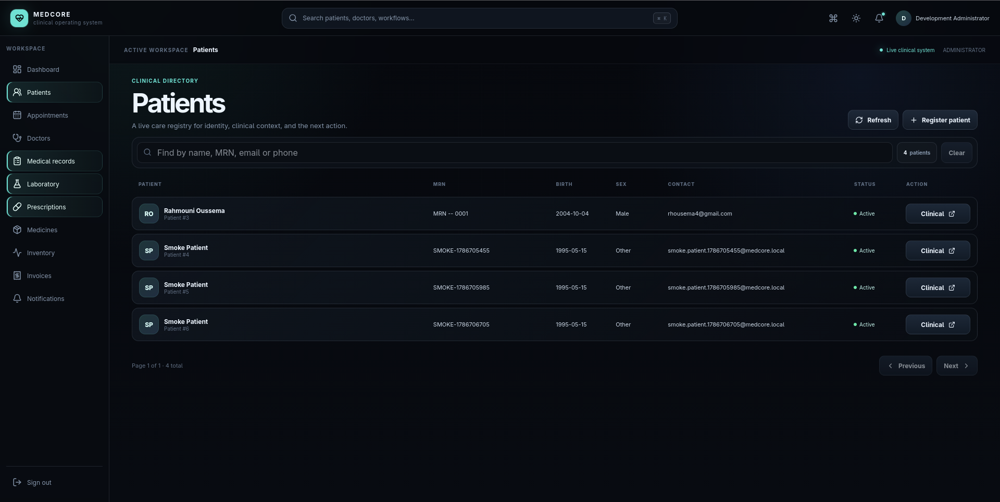 | 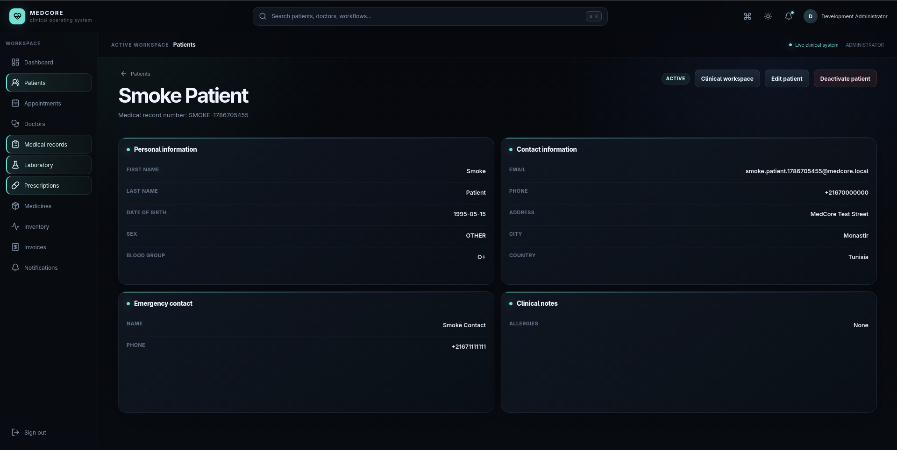 |

### Clinical Workspace

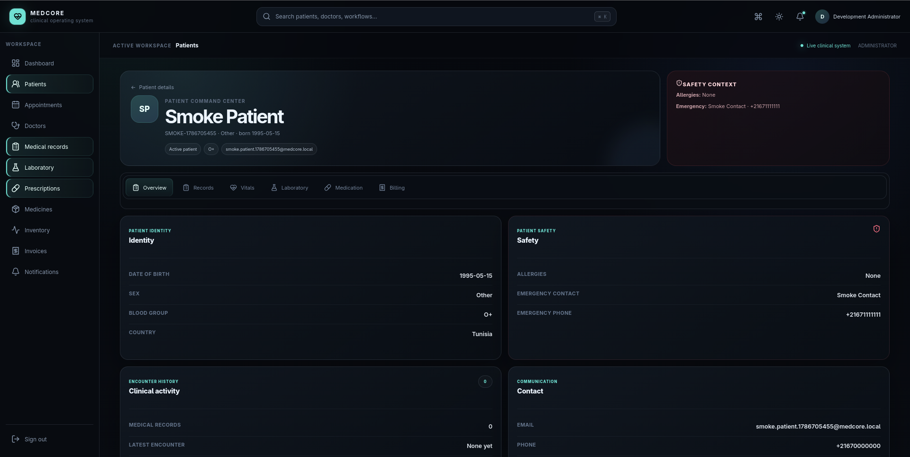

The patient clinical workspace brings record context, vitals capture, diagnosis entry, and diagnosis review into one workflow.

### Doctors & Scheduling

| Doctors Directory | Doctor Detail | Doctor Scheduling |
|---|---|---|
| 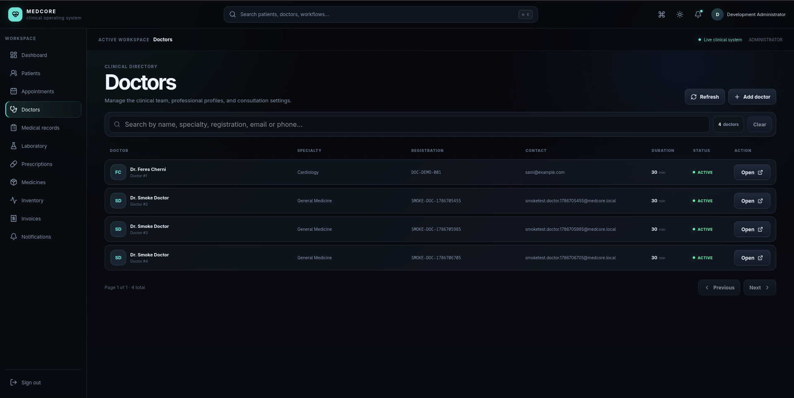 | 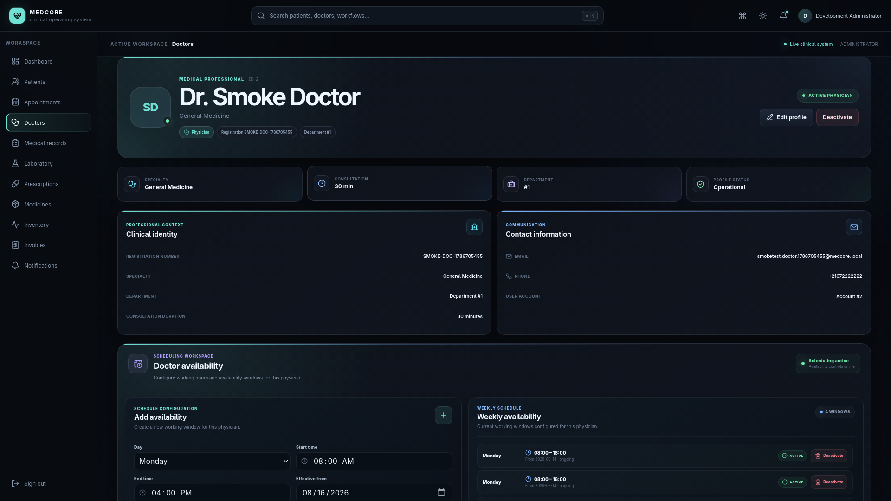 | 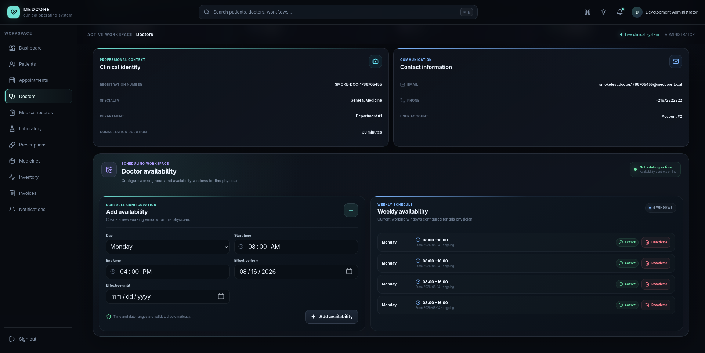 |

### Appointments

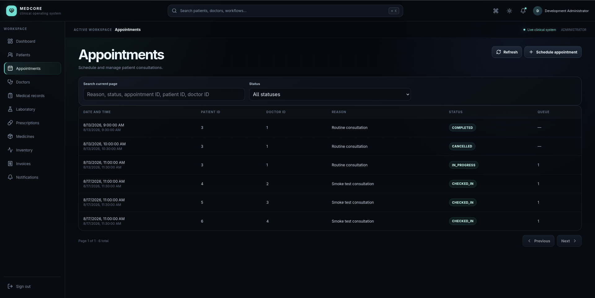

Appointment scheduling with conflict checking, check-in, lifecycle transitions, and cancellation.

### Pharmacy — Medicines

| Medicines Catalog | Create Medicine |
|---|---|
| 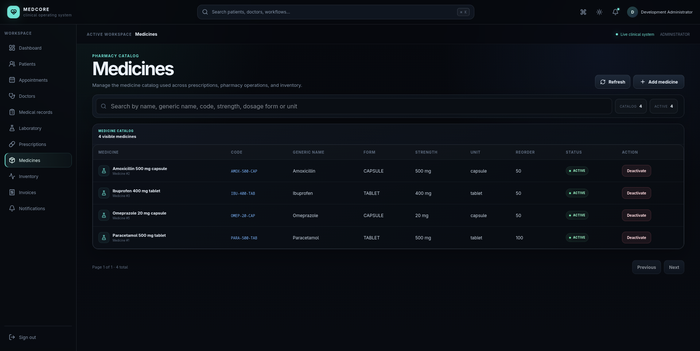 | 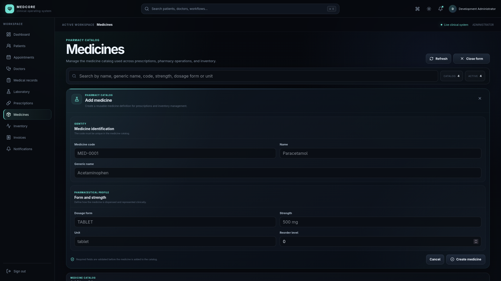 |

### Inventory

| Inventory Overview | Selected Medicine Batches |
|---|---|
| 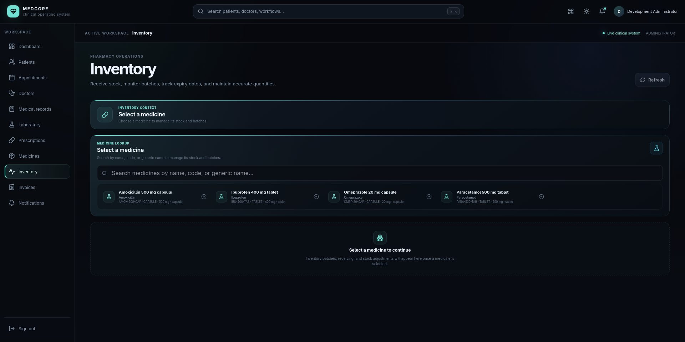 | 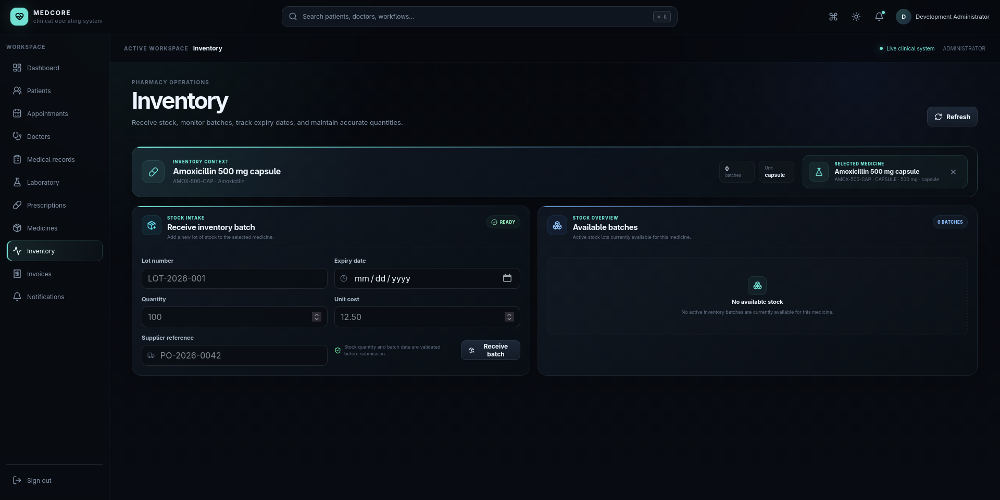 |

Batch intake, expiry tracking, quantity adjustment, and audit-trail stock movements.

### Billing & Notifications

| Invoices | Notifications |
|---|---|
| 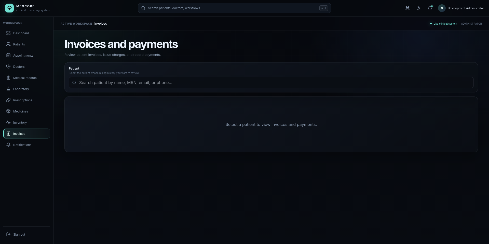 | 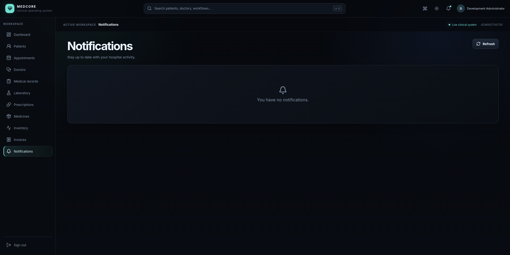 |

---

## Product Overview

MedCore HMS centralizes hospital operations into a single web application with clear boundaries between presentation, application logic, security, persistence, and schema management.

### Core objectives

- Centralize patient and clinical information.
- Coordinate doctors, departments, scheduling, and appointments.
- Support medical records, vitals, diagnoses, laboratory work, and prescriptions.
- Manage medicines, inventory batches, quantities, expiry dates, and stock movements.
- Support invoicing and payment workflows.
- Provide consistent validation, loading, empty, and error states.
- Keep frontend visibility aligned with backend authorization boundaries.
- Provide a professional interface suitable for daily operational use.

---

## Functional Modules

| Module | Capabilities |
|---|---|
| Dashboard / Command Center | Operational overview, metrics, workflow shortcuts, system status |
| Patients | Directory, search, registration, editing, details, clinical workspace |
| Doctors | Directory, creation, editing, profiles, deactivation, scheduling availability |
| Appointments | Creation, conflict checking, check-in, start, completion, cancellation |
| Medical Records | Patient encounters, doctor context, symptoms, clinical notes |
| Vitals | Temperature, blood pressure, heart rate, respiratory rate, SpO₂, weight, height |
| Diagnoses | Diagnosis creation and association with medical records |
| Laboratory | Requests, test items, priority, status, results |
| Prescriptions | Medication orders, dosing, route, frequency, duration, quantity, dispensing, cancellation |
| Billing | Invoices, line items, issue lifecycle, payments, payment voiding |
| Inventory | Medicines, batches, receipts, adjustments, stock movements, expiry tracking |
| Notifications | Workflow and system feedback where available |

---

## Technology Stack

### Frontend

- React
- TypeScript
- Vite
- React Router
- TanStack React Query
- React Hook Form
- Zod
- Axios
- Lucide React
- Framer Motion

### Backend

- Java 21
- Spring Boot
- Spring Framework
- Spring Security
- Spring Data JPA / Hibernate
- JWT authentication
- MapStruct
- Flyway
- MySQL connector
- Springdoc OpenAPI / Swagger
- Spring Boot Actuator
- Spring AOP
- JUnit / Spring Boot Test
- Spring Security Test
- Testcontainers

---

## Architecture

MedCore HMS follows a conventional full-stack separation of concerns.

```text
┌───────────────────────────────────────────────────────────────┐
│                         React Frontend                        │
│  Routing • Pages • Forms • UI State • React Query • Zod       │
└──────────────────────────────┬────────────────────────────────┘
                                │ HTTP / JSON
                                ▼
┌───────────────────────────────────────────────────────────────┐
│                    Spring Boot REST API                       │
│  Controllers • Validation • Services • Security • Mapping     │
└──────────────────────────────┬────────────────────────────────┘
                                │
                                ▼
┌───────────────────────────────────────────────────────────────┐
│                 Spring Data JPA / Hibernate                   │
│                 Repositories • Domain Model                   │
└──────────────────────────────┬────────────────────────────────┘
                                │
                                ▼
┌───────────────────────────────────────────────────────────────┐
│                         MySQL Database                        │
│                 Flyway-managed schema evolution                │
└───────────────────────────────────────────────────────────────┘
```

### Request lifecycle

1. A user initiates an action from a routed React workspace.
2. TanStack Query executes the request or mutation through the Axios API client.
3. Spring Security processes authentication and authorization.
4. The service/application layer validates business rules and orchestrates the use case.
5. Repositories persist or retrieve domain state.
6. The API returns a structured response or application-specific error.
7. The frontend invalidates or updates related queries so the visible workspace stays synchronized.

### Architectural principles

- Separation of concerns between UI, API, business rules, and persistence.
- Feature-oriented frontend organization.
- Reusable modules instead of page-level duplication.
- Explicit validation at client and server boundaries.
- Centralized exception handling.
- Server-side authorization independent of UI visibility.
- Migration-managed schema evolution.
- Explicit confirmation for destructive actions.

---

## Frontend Structure

The frontend is organized around business capabilities rather than a single monolithic page layer.

```text
frontend/src/
├── api/
│   └── client.ts
├── components/
├── features/
│   ├── appointments/
│   ├── auth/
│   ├── dashboard/
│   ├── diagnoses/
│   ├── doctors/
│   ├── inventory/
│   ├── invoices/
│   ├── laboratory/
│   ├── medical-records/
│   ├── medicines/
│   ├── notifications/
│   ├── patients/
│   ├── prescriptions/
│   └── vitals/
├── layout/
├── navigation/
├── router/
├── styles/
└── types/
```

TanStack React Query handles server state, caching, refetching, and mutation lifecycles. Successful mutations invalidate the relevant query keys so patient, doctor, appointment, laboratory, prescription, invoice, inventory, and availability views remain synchronized.

React Hook Form and Zod provide structured form handling and client-side validation. Backend validation remains authoritative.

---

## Backend Structure

The backend follows a layered Spring Boot architecture:

```text
backend/src/main/java/com/medcore/hms/
├── auth/
├── appointment/
├── diagnosis/
├── doctor/
├── doctoravailability/
├── exception/
├── inventory/
├── invoice/
├── laboratory/
├── medicalrecord/
├── medicine/
├── notification/
├── patient/
├── prescription/
├── security/
├── user/
└── vitalsign/
```

Representative backend responsibilities include:

- REST controllers for HTTP boundaries.
- DTOs for stable API contracts.
- Services for use cases and transactions.
- Domain models for statuses and invariants.
- Repositories for persistence access.
- MapStruct mappers for DTO/entity transformations.
- Centralized exception handling.
- Security services and JWT token processing.

---

## Security

Authentication is based on stateless JWT access tokens with refresh-token support.

The backend uses Spring Security with a dedicated JWT authentication filter. The frontend attaches access tokens to authenticated API requests and can refresh the access token when a protected request returns `401`.

Security-related principles include:

- Stateless session management.
- JWT access-token validation.
- Refresh-token rotation support.
- Server-side authorization.
- Password encoding.
- CORS configuration.
- Explicit security headers.
- Protected API routes by default.
- Public access limited to authentication, health, and API documentation endpoints.

### Secrets

**Never commit JWT secrets, database passwords, API keys, or `.env` files containing credentials.**

Use environment variables or a secrets-management system for deployment configuration.

Example:

```bash
export JWT_SECRET="<generate-a-secret-of-at-least-32-UTF-8-bytes>"
```

Generate a strong local secret with:

```bash
openssl rand -base64 48
```

### Demo credentials

For security, the public repository should not contain a production or personal password. Use the project's local development seed/configuration to obtain the current demo account credentials.

---

## Database & Migrations

Database schema evolution is managed with Flyway migrations.

The migration chain includes identity and access tables, organization/patient/doctor tables, appointments and medical records, laboratory, medicines/prescriptions/inventory, billing/payment tables, notifications/audit tables, query indexes, and development reference data.

Typical migration layout:

```text
backend/src/main/resources/db/migration/
├── V1__create_identity_and_access_tables.sql
├── V2__create_organization_patient_and_doctor_tables.sql
├── V3__create_appointment_and_medical_record_tables.sql
├── V4__create_laboratory_tables.sql
├── V5__create_medicine_prescription_and_inventory_tables.sql
├── V6__create_invoice_and_payment_tables.sql
├── V7__create_notification_and_audit_tables.sql
├── V8__create_query_indexes.sql
├── V9__insert_development_reference_data.sql
└── V10__add_payment_audit_columns.sql
```

Migrations should be treated as forward-only schema history. Avoid manual database changes that bypass Flyway.

---

## Local Development

### Prerequisites

- Java 21
- Node.js 20+
- npm (or pnpm)
- MySQL 8+
- Git
- The Maven wrapper shipped in `backend/`

### 1. Clone the repository

```bash
git clone <your-repository-url>
cd medcore-hms
```

### 2. Configure the backend

Provide the database settings and JWT signing secret through the application's environment/profile configuration.

At minimum, configure:

- Database URL
- Database username
- Database password
- JWT signing secret
- Backend profile
- Frontend CORS origin(s)

### 3. Start the backend

```bash
cd backend
./mvnw spring-boot:run
```

The backend is configured for the Spring Boot web application and exposes the API under the project's configured API prefix.

### 4. Start the frontend

In a second terminal:

```bash
cd frontend
npm install
npm run dev
```

Set the frontend API base URL through the Vite environment configuration used by the project.

Example shape:

```bash
VITE_API_BASE_URL=http://localhost:8080/api/v1
```

Do not commit local `.env` files containing secrets.

---

## Quality Gates

The project uses explicit frontend and backend validation commands.

### Frontend

```bash
cd frontend
npx tsc --noEmit
npm run lint
npm run build
```

### Backend

```bash
cd backend
./mvnw clean verify
```

or during local development:

```bash
./mvnw spring-boot:run
```

The project documentation records successful frontend type-checking and production builds, and the backend includes automated testing support including Spring Boot tests, Spring Security tests, and Testcontainers-based database integration testing.

---

## Representative Clinical Workflows

### Patient clinical workspace

1. Open a patient.
2. Select or create the medical-record context.
3. Work from the clinical tabs.
4. Capture vitals, diagnoses, laboratory requests/results, prescriptions, and billing context.
5. Review updated data without leaving the patient workspace.

### Doctor scheduling

1. Open a doctor profile.
2. Open the Scheduling workspace.
3. Review weekly availability.
4. Add a day/time window with effective dates.
5. Validate the start/end and effective date ordering.
6. Deactivate an availability entry with explicit confirmation.

### Inventory

1. Search and select a medicine.
2. Review available inventory batches.
3. Receive a new batch with lot number, expiry, quantity, cost, and supplier reference.
4. Select a batch to inspect stock context.
5. Adjust quantity with a mandatory reason.
6. Review stock movements as an audit trail.

### Appointments

Appointment workflows include creation, conflict detection, check-in, start, completion, and cancellation. Scheduling validation includes future date/time constraints and doctor overlap detection.

### Billing

Billing workflows include invoice creation, issue lifecycle, payment recording, payment history, and payment voiding with an explicit reason and authorization boundary.

---

## UX & Design System

MedCore HMS uses a consistent visual system across operational workspaces.

### Design goals

- High information clarity.
- Professional information density.
- Strong hierarchy between context, content, and actions.
- Reusable cards and feature modules.
- Responsive layouts.
- Explicit loading, empty, and error states.
- Accessible focus states and clear destructive actions.
- Command-oriented navigation for frequent workflows.
- Both light and dark themes.

The interface uses a restrained clinical palette with cyan/blue accent states and purpose-specific colors for success, warning, danger, and scheduling/context modules.

---

## API Discovery

The backend includes OpenAPI / Swagger support for API discovery and interactive endpoint documentation.

When the backend is running, use the project's configured Swagger UI or OpenAPI endpoints from the backend configuration.

Representative API areas include:

```text
/api/v1/auth/*
/api/v1/patients/*
/api/v1/doctors/*
/api/v1/appointments/*
/api/v1/medical-records/*
/api/v1/vitals/*
/api/v1/diagnoses/*
/api/v1/laboratory/*
/api/v1/prescriptions/*
/api/v1/medicines/*
/api/v1/inventory-batches/*
/api/v1/invoices/*
```

The generated OpenAPI catalog remains the authoritative endpoint reference for a tagged release.

---

## Testing Strategy

Recommended release coverage includes:

| Area | Key checks |
|---|---|
| Authentication | Login, invalid credentials, invalid/expired tokens, authorization boundaries |
| Patients | Create, edit, view, clinical workspace, validation failures |
| Doctors | Create, edit, deactivate, availability creation/deactivation |
| Appointments | Create, conflict detection, lifecycle transitions, cancellation |
| Clinical | Medical records, vitals, diagnoses, laboratory, prescriptions |
| Billing | Invoice lifecycle, payments, payment voiding |
| Inventory | Medicine search, batch selection, stock adjustment, movement visibility |
| UX | Light/dark themes, responsive states, focus states, loading/error/empty states |

---

## Production Readiness Notes

MedCore HMS is a completed core application build, but deployment into a real healthcare organization is a separate security, clinical-safety, privacy, and operations phase.

Before real patient use, complete at minimum:

- Penetration testing and JWT/key-management review.
- Least-privilege authorization audit.
- Clinical workflow review by qualified healthcare professionals.
- Data-retention, access-audit, export/deletion, and regional legal review.
- Monitoring and alerting.
- Automated database backups and restoration drills.
- Performance/load testing with realistic datasets.
- Interoperability assessment for HL7/FHIR or local integration requirements.
- Final production architecture diagram, ERD, and complete endpoint catalog.

This distinction is intentional: a strong portfolio application can demonstrate architecture and workflow maturity without claiming regulatory approval or production clinical certification that has not been independently established.

---

## Release Checklist

Before tagging a release:

- [ ] `npx tsc --noEmit` passes.
- [ ] `npm run lint` has no blocking errors.
- [ ] `npm run build` passes.
- [ ] `./mvnw clean verify` passes.
- [ ] Critical clinical and financial workflows are manually regression-tested.
- [ ] Flyway migrations are validated.
- [ ] Authorization boundaries are reviewed.
- [ ] No secrets are committed.
- [ ] Light and dark themes remain readable.
- [ ] README and technical documentation match the tagged repository state.

---

## Project Status

**Status:** Core application build completed.

The current build includes the implemented clinical, operational, pharmacy, inventory, billing, security, validation, responsive UI, and workspace-oriented navigation capabilities described above.

A demo video walkthrough is planned but not yet available — screenshots above cover the primary workspaces in the meantime.

For deeper architecture, deployment, testing, maintenance, security, and operational guidance, see the companion technical documentation in the repository (for example `Documentation.pdf` when included in the release package).

---

## Screenshots Directory

Keep the images used by this README under:

```text
docs/screenshots/
├── login.png
├── dashboard.png
├── patients.png
├── patient-detail.png
├── patient-clinical-workspace.png
├── doctors.png
├── doctor-detail.png
├── doctor-scheduling.png
├── appointments.png
├── medicines.png
├── medicine-create.png
├── inventory.png
├── inventory-selected-medicine.png
├── invoices.png
└── notifications.png
```

This keeps GitHub rendering self-contained and makes the README portable when the repository is cloned.

---

## License

Add the project's chosen license here before publishing the repository publicly. Do not describe the project as open-source until a license file has been intentionally selected and committed.

---

## Author

**Oussema RAHMOUNI**

MedCore HMS was developed as a portfolio-grade full-stack software engineering project with an emphasis on architecture, security, clinical workflow modeling, maintainability, and polished UX.